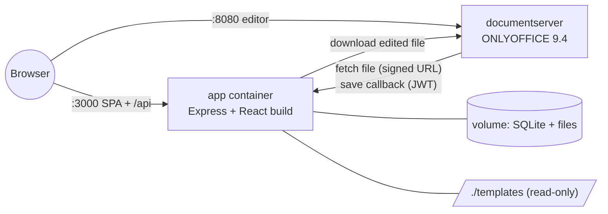

# Office Template Library

A template library for an office app. Users browse **document (DOCX)** and **presentation (PPTX)** templates, preview every page or slide, and click **Use template**. That gives them their own copy, which they edit in the browser with ONLYOFFICE and download. Template files are never modified.

Both products from the brief, the document library and the presentation library, are one application with one template engine. DOCX and PPTX are two *kinds* in a registry, so adding XLSX later is one registry entry.

---

## Quick start

Requirements: **Docker Desktop**. Node.js 24 is needed only for local development and tests.

```bash
git clone https://github.com/Duke0503/office_template_library.git
cd office_template_library
docker compose up --build
```

Open **http://localhost:3000**.

- The galleries work as soon as the app starts.
- ONLYOFFICE Document Server needs **about a minute** on first start. Until it is ready, the editor page shows "The editor is unavailable", with a Retry button.

Optionally, copy `.env.example` to `.env` to change ports or secrets. The defaults work locally.

### Local development (hot reload)

```bash
npm install
docker compose up -d documentserver   # the editor still needs Document Server
npm run dev                           # API on :3000, web on http://localhost:5173
```

### Tests

```bash
npm test               # 20 API tests (Vitest + Supertest), no Docker needed
npm run typecheck

# End-to-end against the full stack (Playwright)
docker compose up -d --build
npx playwright install chromium   # once
npm run test:e2e
```

---

## Features

| Brief requirement | Where |
|---|---|
| Grid of templates with thumbnail, name, description, category | `/templates/docx`, `/templates/pptx` |
| Search and category filter | Search box (debounced, kept in the URL) and category chips |
| Preview | A dialog with every page or slide, a filmstrip and keyboard paging; a full-screen sheet on phone |
| Use template → new document | "Use template" makes a checksum-verified copy, then opens the editor |
| Edit in an integrated editor | ONLYOFFICE Document Server, for both DOCX and PPTX |
| Save and download | Saved when the editor closes; download from the editor or My documents |
| The original template never changes | Read-only storage, copy-on-create, tests compare SHA-256 before and after |
| ≥ 5 DOCX templates, ≥ 3 PPTX sets | 6 DOCX and 4 PPTX, self-authored (`scripts/generate-templates.ts`) |
| Add templates without changing the UI | Edit `templates/manifest.json`, then restart or run the import. No rebuild needed |
| Loading, error and not-found states | Skeletons, error alerts with Retry, empty states, not-found pages |
| Basic formatting preserved | The e2e test edits a DOCX, then checks tables, bold text and content after the round trip |

Extras: light and dark theme, responsive layout from phone to desktop, template revisions, archiving, and a "My documents" list.

---

## Architecture

**Modular monolith, hexagonal per bounded context.** One Node process serves the API and the built React app. ONLYOFFICE Document Server runs beside it as a separate, unmodified container.



| Module | Role | Owns |
|---|---|---|
| `catalog` | Templates, categories, revisions, previews, import | `categories`, `templates`, `template_revisions` |
| `workspace` | Documents: copy-on-create, versions, download | `documents` |
| `editor` | Anti-corruption layer over ONLYOFFICE: signed config, file links, callbacks | — |

Each module has `domain/` (rules, no framework imports), `application/` (services and ports) and `adapters/` (HTTP, Drizzle, storage). The modules talk only through ports. For example, `workspace` gets templates through the catalog's `TemplateSource`. `apps/api/src/app.ts` is the only place adapters are wired.

The planning artifacts are in the repo:

- Spec: `_bmad-output/specs/spec-office-template-library/SPEC.md`
- Architecture spine (AD-1 to AD-14): `_bmad-output/planning-artifacts/architecture/…/ARCHITECTURE-SPINE.md`
- UX: `_bmad-output/planning-artifacts/ux-designs/…/DESIGN.md` and `EXPERIENCE.md`
- Domain model: `docs/domain-model.json`, rendered in `docs/domain-viz/`

### Stack

| Layer | Technology |
|---|---|
| Frontend | React 19, TypeScript, Vite 8, Tailwind CSS 4, shadcn/ui (Radix), TanStack Query, React Router |
| Backend | Node.js 24, Express 5, TypeScript, zod, pino |
| Database | SQLite (better-sqlite3) through Drizzle ORM, with migrations in `apps/api/drizzle/` |
| Editor | ONLYOFFICE Document Server Community Edition 9.4.0 (Docker) |
| Tests | Vitest, Supertest, Playwright |
| Seed content | `docx` and `pptxgenjs` generate the templates; the ONLYOFFICE conversion API renders previews |

### How templates are stored and served

1. `templates/manifest.json`, `templates/files/` and `templates/previews/` are committed. Docker mounts the folder **read-only**.
2. On start (or with `npm run templates:import`), the importer validates each file and stores it:
   - It checks the ZIP signature, and that the OOXML main content type matches the declared kind.
   - It copies the file to `STORAGE_ROOT/templates/{id}/r{revision}/`, marks it read-only and verifies the SHA-256.
   - Only then does it commit the revision row.
   - A changed file becomes revision n+1. The old revision's files stay.
3. The gallery serves preview PNGs from URLs that include the revision, so browsers cache them forever. A new revision means new URLs.

### How a copy is made without touching the original

- Runtime code gets storage only as a **read-only** interface for templates. The importer is the only writer, and it never overwrites a key.
- "Use template" asks the catalog for **one fixed revision descriptor** (storage key and SHA-256). It stream-copies that file to `documents/{id}/v1.{ext}` and rejects the copy if its checksum differs.
- Every save writes a **new** file `v{n+1}`, under a per-document lock, using an atomic link that never overwrites. The document row then moves to the new version and a new editor key.
- Tests: the API tests compare every template's SHA-256 before and after create, save and download. The e2e test downloads a fresh copy after an edit and checks it is byte-identical to the first copy.

### ONLYOFFICE integration

- **JWT in both directions:** the API signs editor configs, and Document Server signs its callbacks with the same secret.
- **Version-bound file links:** Document Server downloads the file through a short-lived link that names one document version.
- **Saving:** Document Server sends the "ready to save" callback a few seconds after the editor closes. The API downloads the edited file, rewriting its host to the internal Document Server address, and stores it as the next version. It replies `{"error":0}` only after the save is committed. A stale or duplicate callback is ignored.

### Error handling

- **API:** every error uses one envelope, `{ "error": { "code", "message" } }`, with an HTTP status (see [docs/api.md](docs/api.md)). Zod validates all input. No stack traces are returned.
- **Import:** a broken manifest entry is reported and skipped, and the rest still import.
- **Web:**
  - Every screen has loading skeletons, an error alert with Retry, empty states with a way out, and not-found pages.
  - "Use template" shows progress and a toast on failure.
  - When Document Server is down, the editor explains why and still offers Download.

### Security notes

- No path from the client ever reaches the file system. Files are addressed by server-generated keys, and the storage adapter rejects keys that escape its root.
- There is no upload endpoint. Templates come only from the manifest, and their file types are verified.
- ONLYOFFICE traffic is signed, file links expire after 10 minutes, and the tokens are redacted from logs.
- Out of scope per the brief: authentication. The app assumes a single local user.

---

## Adding or updating a template

1. Put the `.docx` or `.pptx` in `templates/files/` and add an entry to `templates/manifest.json`.
2. Render its previews: `docker compose up -d documentserver`, then `npm run templates:render -- <slug>`.
3. Restart the app (`docker compose restart app`) or run `docker compose exec app node dist/import.js`.

The gallery picks it up, with no UI change and no rebuild. Replacing a file creates a new revision. Removing an entry archives the template, and documents made from it keep working.

---

## Project layout

```text
apps/api/        Express API (catalog, workspace, editor modules), Drizzle migrations, tests
apps/web/        React app (routes, components, shadcn/ui)
packages/shared/ Kind registry and API types shared by both apps
templates/       manifest.json, template files, preview images
scripts/         generate-templates.ts, render-previews.ts
e2e/             Playwright end-to-end tests
docs/            API and data model, domain model and rendered views
```

---

## Status

### Done

- Both products: document and presentation galleries, search, category filter, preview, use template, ONLYOFFICE editing, save on close, download, and My documents.
- Template data model, manifest import with revisions and archiving, and file type validation.
- 20 API tests and 10 Playwright e2e tests (8 gallery and state tests, 2 editor round trips).
- Docker Compose with one command, plus light and dark themes and responsive layouts.

### Not done and limits

- **No authentication or per-user documents.** It is a single local user, as the brief does not require accounts.
- **Saving happens when the editor closes.** Force-save is off, so a document is not saved while it is still open. Closing the tab also triggers the save after a few seconds.
- **No rename or delete for documents.** Older versions stay on disk with no UI to browse them.
- **Previews are rendered offline.** They are committed images; a new template needs `npm run templates:render`, which requires Document Server.
- **Local deployment only.** There is no HTTPS or reverse proxy. For a hosted setup, put both services behind one proxy and set `PUBLIC_DOCSERVER_URL`.
- **ONLYOFFICE Community Edition** allows up to 20 simultaneous connections. It is AGPL-3.0 and runs as an unmodified separate service; this app talks to it only over its public HTTP API.
- **Linting:** typescript-eslint does not support TypeScript 7 yet, so `tsc --noEmit` is the quality gate.

### Extending

- **XLSX:** add a `xlsx` entry (with documentType `cell`) to `packages/shared/src/kinds.ts` and one icon in `apps/web/src/lib/kind-icons.tsx`. The importer, API, gallery and editor follow the registry.
- **Another editor:** replace `apps/api/src/modules/editor/` with an adapter for a different editor (Collabora, Microsoft 365). The catalog and workspace do not change.

---

## Third-party software and licenses

| Package | License |
|---|---|
| ONLYOFFICE Document Server (Docker image, separate service) | AGPL-3.0 |
| @onlyoffice/document-editor-react | Apache-2.0 |
| React, React Router, TanStack Query, Express, zod, better-sqlite3, pino, jsonwebtoken, adm-zip | MIT |
| Drizzle ORM | Apache-2.0 |
| Tailwind CSS, shadcn/ui, Radix UI, sonner, next-themes, tw-animate-css, cn | MIT |
| class-variance-authority | Apache-2.0 |
| lucide-react | ISC |
| Geist font (@fontsource-variable/geist) | OFL-1.1 |
| docx, pptxgenjs (template generation) | MIT |
| Vite, Vitest, Supertest, tsx, concurrently | MIT |
| Playwright | Apache-2.0 |

The template content and sample data are original, generated by `scripts/generate-templates.ts`.

## AI assistance

This project was planned and built with **Claude Code (Anthropic)** and the open-source **BMAD Method** workflow.

- I made the product and design decisions: the editor choice, the UI direction, scope, and the domain decisions D1 to D4.
- Claude drafted the spec, the domain model, the architecture and the code, and wrote the tests. Independent AI review passes checked the architecture before implementation.
- Every artifact is in `_bmad-output/` and `.context/`, so the reasoning can be audited.
