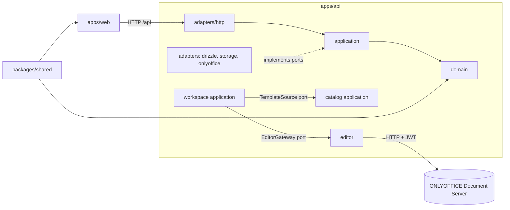
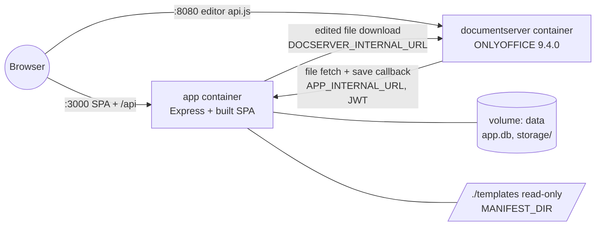
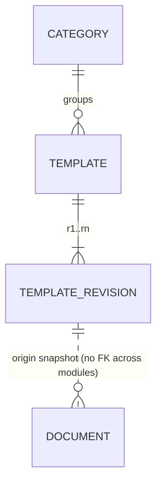

# Architecture Spine — Office Template Library

## Design Paradigm

A **modular monolith** with **hexagonal architecture** in each bounded context (D1: three bounded contexts). One Node process serves the API and the built web app. ONLYOFFICE Document Server runs beside it as a separate container.

| Layer | Directory (per module) | May import |
|---|---|---|
| Domain: aggregates, value objects, rules | `apps/api/src/modules/<module>/domain/` | `packages/shared` only |
| Application: commands, queries, ports | `apps/api/src/modules/<module>/application/` | own domain, other modules' **ports** |
| Adapters: HTTP routes, Drizzle repositories, file storage, ONLYOFFICE | `apps/api/src/modules/<module>/adapters/` | own application, libraries |
| Composition root | `apps/api/src/app.ts` | everything; wires adapters into ports |

Modules: `catalog`, `workspace`, `editor` (the anti-corruption layer over ONLYOFFICE).

## Invariants & Rules



### AD-1 — Hexagonal modules with inward dependencies [ADOPTED]

- **Binds:** all
- **Prevents:** business rules spread into routes, SQL or ONLYOFFICE code. It also prevents one module reaching into another module's internals.
- **Rule:**
  - Domain code imports no Express, Drizzle, `fs` or ONLYOFFICE code.
  - A module uses another module only through that module's exported port interfaces.
  - Adapters are wired only in `app.ts`.

### AD-2 — Template files are structurally read-only

- **Binds:** CAP-4, CAP-5, CAP-8
- **Prevents:** any edit, save or copy path writing to a template original.
- **Rule:**
  - Runtime code receives a `TemplateStore` port that has read methods only.
  - Only `TemplateImporter` receives the writer. It sets each stored template file read-only and never writes over an existing key.
  - An automated test asserts by sha256 checksum, not file mode, that every template file is unchanged after create, save and download.

### AD-3 — One kind registry

- **Binds:** CAP-1, CAP-3, CAP-5, CAP-6, all kind-specific code
- **Prevents:** DOCX and PPTX branches drifting apart, and an XLSX addition needing a hunt through the code.
- **Rule:**
  - `packages/shared/src/kinds.ts` maps each kind to its extension, MIME type, OOXML main content type, ONLYOFFICE `documentType`, labels and preview unit.
  - The API exposes only `kind`. The web reads labels from the registry.
  - No `kind === '…'` comparisons exist outside the registry.

### AD-4 — The manifest in the repo is the only source of templates

- **Binds:** CAP-8, CAP-10, D2 (a template update creates a new revision), D4 (an archived template leaves the gallery but its documents keep working)
- **Prevents:**
  - Templates being defined in two places.
  - Adding a template needing an image rebuild.
  - A new revision appearing on every start.
- **Rule:**
  - `templates/manifest.json` lists the categories and templates, each with a slug, kind, name, category slug, description, source file and committed preview images.
  - The folder is mounted read-only into the app container at `MANIFEST_DIR`. Stored files live under `STORAGE_ROOT` (a named volume).
  - The import upserts by `(kind, slug)`. A changed source checksum creates the next revision.
  - A template with `"archived": true`, or missing from the manifest, is archived.
  - The seed files are committed, and the generator never runs at build or start.

### AD-5 — Each module owns its tables

- **Binds:** CAP-4, CAP-7
- **Prevents:** two owners of one entity, and joins across module boundaries.
- **Rule:**
  - `catalog` owns `categories`, `templates` and `template_revisions` (unique on `templateId, revision`). `workspace` owns `documents`.
  - Each module defines its own Drizzle schema file.
  - `workspace` stores a `TemplateOrigin` snapshot (template id, revision, name) and never joins catalog tables.
  - All tables live in one SQLite file in WAL mode with `busy_timeout = 5000`.

### AD-6 — A document changes only through serialised workspace commands

- **Binds:** CAP-4, CAP-5, CAP-6
- **Prevents:** lost or half-written versions, two writers of one version, and ONLYOFFICE serving a stale cache.
- **Rule:**
  - Only `createDocumentFromTemplate` and `saveEditedVersion` mutate a document. A document has no persisted editing status.
  - Force-save stays off, so only callback status 2 saves.
  - Saves for one document run under an in-process lock:
    1. Download the new version to a temp file.
    2. Rename it to `documents/{documentId}/v{n}.{ext}`, never overwriting an existing file.
    3. In one transaction, set `version = n` and `editorKey = {documentId}-v{n}`.
  - A callback is applied only if its `key` equals the current `editorKey`.

### AD-7 — ONLYOFFICE contract

- **Binds:** CAP-5
- **Prevents:** unsigned or lost saves, and confusion between URLs the browser can reach and URLs only containers can reach.
- **Rule:**
  - Compose sets `JWT_ENABLED=true`, `JWT_SECRET=${ONLYOFFICE_JWT_SECRET}` and `ALLOW_PRIVATE_IP_ADDRESS=true` on Document Server.
  - The API signs every editor config, and the config response carries `PUBLIC_DOCSERVER_URL` for the browser.
  - Document Server fetches the file from `APP_INTERNAL_URL` with a signed URL bound to the document id and version, valid for 10 minutes.
  - `POST /api/editor/callback/:documentId` reads the token from `Authorization: Bearer` (the `payload` claim) or from the body `token`, and trusts only the verified claims.
  - Every URL that Document Server returns has its origin rewritten to `DOCSERVER_INTERNAL_URL`, and only that host is fetched.
  - The callback replies `{"error":0}` only after the save commits (or for status 4), and `{"error":1}` otherwise.

### AD-8 — One API contract shared by API and web

- **Binds:** all endpoints
- **Prevents:** request and response shapes diverging between API and web.
- **Rule:**
  - REST JSON lives under `/api`.
  - Zod schemas in `packages/shared/src/api.ts` validate requests in the API and type the web client.
  - Errors use `{ "error": { "code": "TEMPLATE_NOT_FOUND", "message": "…" } }` with UPPER_SNAKE codes and the matching HTTP status. Using an archived template returns `409 TEMPLATE_ARCHIVED`.
  - Categories are addressed by slug.

### AD-9 — Files are reached by id, never by path

- **Binds:** CAP-4, CAP-6, CAP-8
- **Prevents:** path traversal, and serving or importing files of the wrong type.
- **Rule:**
  - Storage keys are generated by the server.
  - The storage adapter resolves keys under its root and rejects any key that escapes it.
  - The importer checks the ZIP signature and the OOXML main content type for the kind.
  - There is no upload endpoint.

### AD-10 — Web state rules

- **Binds:** CAP-1, CAP-2, CAP-3, CAP-7, CAP-9
- **Prevents:** duplicated server state, and filters that are lost on reload.
- **Rule:**
  - Server data comes only through TanStack Query hooks in `apps/web/src/api/`.
  - Gallery filters (`q`, `category` slug) live in the URL search params.
  - Every route renders explicit loading, error (with retry), empty and not-found states.
  - Components come from shadcn/ui, following the `ui-shadcn` skill.

### AD-11 — Deployment

- **Binds:** all
- **Prevents:** a run that depends on the host machine's setup.
- **Rule:**
  - `docker compose up` starts two services: `documentserver` and `app` (Express serving the API and the built SPA).
  - The startup import finishes before the server listens.
  - `.env.example` lists every variable, with working local defaults.

### AD-12 — Tests on the critical flows

- **Binds:** CAP-4, CAP-5, CAP-8, CAP-9
- **Prevents:** regressions in copy isolation and save handling going unnoticed.
- **Rule:**
  - Vitest unit tests cover domain rules.
  - Supertest API tests use a temp storage root and a fake `EditorGateway`. They cover copy isolation by checksum, revision import, not-found and archived errors, bad-JWT and stale-key callbacks, and path traversal.

### AD-13 — A document is created from one fixed revision descriptor

- **Binds:** CAP-4, CAP-8
- **Prevents:** a document recording revision n while holding the bytes of revision n+1.
- **Rule:**
  - `TemplateSource.getPublishedRevision(templateId)` returns one descriptor `{ templateId, revision, kind, name, storageKey, sha256 }`.
  - `DocumentFactory` copies by that `storageKey`, and the copy's sha256 must equal that `sha256`.
  - The importer stores the file and verifies its checksum before it commits the revision row.

### AD-14 — Previews are committed files with stable URLs

- **Binds:** CAP-1, CAP-3
- **Prevents:** two producers of previews, off-by-one numbering, and stale images after a revision.
- **Rule:**
  - The importer copies the committed previews. `PreviewRenderer` is used only by the offline `templates:render` script.
  - Previews are numbered from 1, and the thumbnail is preview 1.
  - The API returns full URLs that include the revision: `/api/templates/:id/revisions/:rev/previews/:n`. They are served with immutable caching, and the web never builds them.

## Consistency Conventions

| Concern | Convention |
| --- | --- |
| Naming | Domain words from the glossary: Template, Category, Document, Preview, TemplateOrigin, EditorKey. Files in kebab-case. Commands are verbs (`createDocumentFromTemplate`). Events are `<context>.<aggregate>.<past-tense>` |
| IDs and dates | UUIDs from `crypto.randomUUID()`. ISO-8601 UTC strings in the API |
| Errors | Domain errors (`TemplateNotFoundError`, …) are mapped to the AD-8 envelope by one Express error middleware. Never return a raw stack |
| Logging | pino JSON. Log template id, document id and callback status, never file contents or tokens |
| Config | Environment variables parsed once with zod in `apps/api/src/config.ts` |
| Auth | None: single anonymous user. Template import is CLI-only |
| Tests | `*.test.ts` next to the code |

## Stack

| Name | Version |
| --- | --- |
| Node.js | 24.22.1 |
| TypeScript | 7.0.2 |
| Express | 5.3.0 |
| drizzle-orm / drizzle-kit | 0.45.4 / 0.31.11 |
| better-sqlite3 | 13.0.3 |
| zod | 4.6.7 |
| jsonwebtoken | 9.0.3 |
| pino | 10.4.0 |
| React | 19.3.1 |
| Vite | 8.3.5 |
| Tailwind CSS | 4.3.3 |
| shadcn (CLI) | 4.23.0 |
| @tanstack/react-query | 5.105.0 |
| react-router | 8.5.1 |
| @onlyoffice/document-editor-react / doceditor-types | 2.3.0 / 9.4.3 |
| Vitest / Supertest | 5.0.5 / 7.3.1 |
| docx / pptxgenjs (seed generation) | 9.15.0 / 4.0.1 |
| onlyoffice/documentserver | 9.4.0 |

## Structural Seed





```text
office-template-library/
  apps/api/src/
    modules/catalog/{domain,application,adapters}/
    modules/workspace/{domain,application,adapters}/
    modules/editor/            # ONLYOFFICE adapter: config signing, callback, file download
    shared/                    # storage, db, errors, logger
    app.ts  server.ts  config.ts  import.ts
  apps/web/src/
    routes/  components/  api/
  packages/shared/src/         # kinds registry, zod API schemas
  templates/                   # manifest.json, files/, previews/ (committed)
  scripts/                     # generate-templates.ts, render-previews.ts
  docker-compose.yml  Dockerfile  .env.example
```

**API surface (seed):**

| Method and path | Purpose |
|---|---|
| `GET /api/categories?kind=` | Categories that have published templates of the kind |
| `GET /api/templates?kind=&q=&category=` | Gallery |
| `GET /api/templates/:id` | Template detail with preview URLs |
| `GET /api/templates/:id/revisions/:rev/previews/:n` | Preview image, immutable |
| `POST /api/templates/:id/documents` | Use template. Returns 201 with the new document |
| `GET /api/documents` | My documents |
| `GET /api/documents/:id` | Document detail |
| `GET /api/documents/:id/editor-config` | Signed ONLYOFFICE config plus the public Document Server URL |
| `GET /api/documents/:id/download` | Current version as an attachment |
| `GET /api/files/documents/:id/versions/:n?token=` | Document Server file fetch |
| `POST /api/editor/callback/:id` | Document Server callback |
| `GET /api/health` | Liveness, plus Document Server reachability |

## Capability → Architecture Map

| Capability | Lives in | Governed by |
| --- | --- | --- |
| CAP-1 Browse gallery | catalog gallery query, web `/templates/:kind` | AD-3, AD-10, AD-14 |
| CAP-2 Search and filter | catalog gallery query, URL params | AD-8, AD-10 |
| CAP-3 Preview | committed previews, preview route, web preview dialog | AD-14 |
| CAP-4 Create from template | workspace `DocumentFactory` | AD-2, AD-5, AD-6, AD-9, AD-13 |
| CAP-5 Edit | editor module, web `/documents/:id/edit` | AD-6, AD-7 |
| CAP-6 Download | workspace download route | AD-6, AD-9 |
| CAP-7 My documents | workspace documents query, web `/documents` | AD-5, AD-10 |
| CAP-8 Template management | `templates/manifest.json`, `TemplateImporter` | AD-2, AD-4, AD-13 |
| CAP-9 States | web routes, API error envelope | AD-8, AD-10 |
| CAP-10 Seed data | committed files from `scripts/generate-templates.ts`, import on start | AD-4 |

## Deferred

- **Document rename and delete (OQ1).** Adds workspace commands only, with no AD change.
- **Authentication and per-user isolation.** Out of scope per the SPEC.
- **Hosted deployment, HTTPS and reverse proxy.** Out of scope. Compose is local only.
- **Old document versions.** They are kept on disk with no browsing UI and no cleanup.
- **Force-save and co-editing across tabs.** Off. ONLYOFFICE handles one session per key.
- **Linting.** typescript-eslint does not support TypeScript 7 yet. `tsc --noEmit` is the gate.
- **ONLYOFFICE 10.x.** It changes JWT claims. Revisit after submission.
- **End-to-end browser tests (Playwright).** Optional if time remains.
- **XLSX.** One registry entry plus the `cell` documentType (AD-3).
