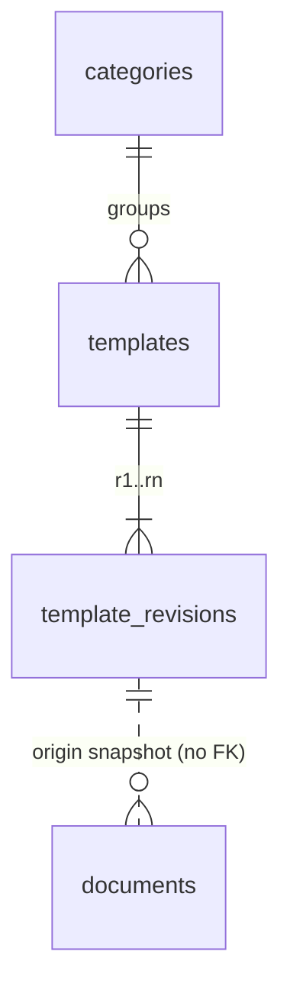

# API and data model

All endpoints are JSON under `/api`. The request and response types live in `packages/shared/src/api.ts` and are shared by the API and the web app.

## Errors

Every error uses one envelope, with an UPPER_SNAKE code and the matching HTTP status:

```json
{ "error": { "code": "TEMPLATE_NOT_FOUND", "message": "No template with id 42." } }
```

| Code | Status | When |
|---|---|---|
| `VALIDATION_FAILED` | 400 | A query or path parameter is invalid, for example `kind=xlsx` |
| `TEMPLATE_NOT_FOUND` | 404 | Unknown template id |
| `PREVIEW_NOT_FOUND` | 404 | Unknown template revision or page number |
| `DOCUMENT_NOT_FOUND` | 404 | Unknown document id |
| `DOCUMENT_FILE_MISSING` | 404 | A stored file is missing from disk |
| `TEMPLATE_ARCHIVED` | 409 | "Use template" on an archived template |
| `INVALID_FILE_TOKEN` | 403 | The Document Server file link is missing, expired or for another version |
| `INVALID_EDITOR_TOKEN` | 403 | An editor callback is not signed with the shared JWT secret |
| `ROUTE_NOT_FOUND` | 404 | No such API route |
| `INTERNAL_ERROR` | 500 | Anything unexpected. Stack traces are never returned |

## Catalog

### `GET /api/templates?kind=docx|pptx&q=&category=`

The gallery. It returns only published templates of one kind. `q` matches the name, description and category name, case-insensitively. `category` is a category slug.

```json
{
  "items": [
    {
      "id": "6f1c…",
      "kind": "docx",
      "slug": "invoice",
      "name": "Invoice",
      "description": "A service invoice with billing details, itemised amounts, VAT and payment instructions.",
      "category": { "slug": "finance", "name": "Finance" },
      "revision": 1,
      "thumbnailUrl": "/api/templates/6f1c…/revisions/1/previews/1",
      "previewCount": 2
    }
  ]
}
```

### `GET /api/categories?kind=docx|pptx`

Returns the categories that have published templates of the kind, with counts: `{ "items": [{ "slug": "business", "name": "Business", "templateCount": 3 }] }`.

### `GET /api/templates/:id`

Returns a template summary plus `status` (`published` or `archived`), `updatedAt` and `previews: [{ "n": 1, "url": "…" }]`. Archived templates stay readable, so old links show a clear state.

### `GET /api/templates/:id/revisions/:rev/previews/:n`

Returns a PNG. Numbering starts at 1, and preview 1 is the thumbnail. The URL includes the revision, so the response is served with `Cache-Control: immutable`.

## Workspace

### `POST /api/templates/:id/documents`

"Use template". It copies the template's current revision into a new document, verifies the copy's SHA-256 against the revision, and returns `201` with a `Location` header:

```json
{
  "id": "9b2e…",
  "kind": "docx",
  "title": "Invoice",
  "origin": { "templateId": "6f1c…", "revision": 1, "templateName": "Invoice" },
  "version": 1,
  "createdAt": "2026-10-30T09:12:00.000Z",
  "updatedAt": "2026-10-30T09:12:00.000Z",
  "downloadUrl": "/api/documents/9b2e…/download"
}
```

### `GET /api/documents` · `GET /api/documents/:id`

My documents, newest first, or a single document.

### `GET /api/documents/:id/download`

Returns the current version as an attachment with the right MIME type.

## Editor (ONLYOFFICE)

### `GET /api/documents/:id/editor-config`

Returns `{ documentServerUrl, config }`. `config` is the ONLYOFFICE editor configuration, signed with `ONLYOFFICE_JWT_SECRET` in `config.token`. Its `document.key` is `{documentId}-v{version}`, so every saved version gets a fresh editor cache key.

### `GET /api/files/documents/:id/versions/:n?token=…`

Document Server fetches the file from here. The token is a JWT signed with `APP_SECRET`, bound to the document id and version, and valid for 10 minutes.

### `POST /api/editor/callback/:id`

The Document Server callback.

- The JWT is read from `Authorization: Bearer` (with the claims under `payload`) or from a body `token`. Unsigned requests get `403 {"error":1}`.
- **Status 2** (ready to save): the edited file is downloaded through `DOCSERVER_INTERNAL_URL` and stored as the next version, under a per-document lock. A callback whose `key` is not the current editor key is ignored.
- **Status 4** (closed without changes) is acknowledged.
- The reply is `{"error":0}` only once the outcome is final, and `{"error":1}` if storing failed, so Document Server keeps the edits.

### `GET /api/health`

Returns `{ "status": "ok", "documentServer": "up" | "down" }`.

## Data model

SQLite, one file, in WAL mode. Each module owns its tables, and there are no joins across modules.



| Table | Owner | Columns |
|---|---|---|
| `categories` | catalog | `id`, `slug` (unique), `name`, `sort_order` |
| `templates` | catalog | `id`, `kind`, `slug` (unique per kind), `name`, `description`, `category_id`, `status` (`published` or `archived`), `current_revision`, `sort_order`, `created_at`, `updated_at` |
| `template_revisions` | catalog | `template_id` + `revision` (primary key), `storage_key`, `sha256`, `size_bytes`, `preview_count`, `created_at` |
| `documents` | workspace | `id`, `kind`, `title`, `origin_template_id`, `origin_revision`, `origin_template_name`, `version`, `storage_key`, `editor_key` (unique), `created_at`, `updated_at` |

### Files on disk (`STORAGE_ROOT`)

```text
app.db
templates/{templateId}/r{revision}/source.{docx|pptx}   # read-only, never overwritten
templates/{templateId}/r{revision}/previews/{n}.png
documents/{documentId}/v{version}.{docx|pptx}           # one file per saved version
```

### Template manifest (`templates/manifest.json`)

The only source of templates. Edit it, then restart the app or run `npm run templates:import`.

```json
{
  "categories": [{ "slug": "finance", "name": "Finance" }],
  "templates": [
    {
      "kind": "docx",
      "slug": "invoice",
      "name": "Invoice",
      "category": "finance",
      "description": "A service invoice with …",
      "file": "files/invoice.docx",
      "previews": "previews/invoice",
      "archived": false
    }
  ]
}
```

- `previews` is a folder of `1.png`, `2.png`, ….
- A changed file creates a new revision. Documents keep the revision they were made from.
- A template removed from the manifest, or marked `"archived": true`, leaves the gallery. Its documents keep working.
