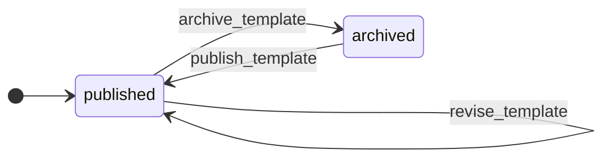

# Template Catalog

`catalog`

## Purpose & classification

> Browse, search, filter and preview templates of each kind. Add or update templates without changing the UI.

**Subdomain type:** core · **Status:** target · agreed goal · **Strategic importance:** high

**Context map patterns:** open-host service

The catalog holds every template and category. It serves the gallery, the preview and the template file that a document is copied from.

**Subdomain:** Template Catalog (core)

Templates, categories and previews that users browse, search and preview.

## Ubiquitous language

| Term | Source | Note |
|---|---|---|
| `TemplateId` | domain-primitive | Identifies one template. Clients never pass file paths, only this id. |
| `TemplateKind` | value-object | The office format of a template or document. Each kind knows its MIME type, extension and editor type. |
| `StoredFile` | value-object | A file in storage: storage key, MIME type, size and sha256 checksum. |
| `PreviewImage` | value-object | One rendered page or slide image with its order and size. |
| `TemplateStatus` | value-object | Type of field status on Template |
| `CategoryId` | value-object | Type of field id on Category |

## Aggregates

### Template · `templates`
_target · agreed goal_
A template is a ready-made DOCX or PPTX file that users copy. It holds the metadata, the current file and the previews. Its file is never rewritten.
**Identity:** `id : TemplateId`. Identifies one template. Clients never pass file paths, only this id.
> Must be correct together: kind, current file, revision, thumbnail and previews.
**Invariants:**
- The template kind matches the MIME type of its file.
- A published template has a thumbnail and at least one preview.
- A stored template file is never rewritten. A new revision gets a new storage key (D2: a template update creates a new revision).
- The slug is unique within its kind.
- A revision row is committed only after its file is stored and its checksum verified.
**14 fields:**
| Field | Type / reference | Required | Description |
|---|---|---|---|
| `id` | `TemplateId` | yes |  |
| `kind` | `TemplateKind` | yes |  |
| `slug` | `string` | yes |  |
| `name` | `string` | yes |  |
| `description` | `string` | yes | One or two sentences shown on the gallery card. |
| `categoryId` | → `category` | yes |  |
| `revision` | `integer` | yes |  |
| `file` | `StoredFile` | yes | The current revision's file in the read-only template store. |
| `revisions` | `TemplateRevision[]` | yes | Every stored revision: number, storage key, sha256, preview count. The highest is current. |
| `thumbnail` | `PreviewImage` | yes |  |
| `previews` | `PreviewImage[]` | yes | One image per page (DOCX) or per slide (PPTX), in order. |
| `status` | `TemplateStatus` | yes |  |
| `createdAt` | `datetime` | yes |  |
| `updatedAt` | `datetime` | yes |  |

### Category · `categories`
_target · agreed goal_
A category is a label that groups templates, such as Business or Education. One list serves both kinds (D3: categories are shared by both template kinds).
**Identity:** `id : CategoryId`
> Must be correct together: slug and name.
**Invariants:**
- The category slug is unique.
**3 fields:**
| Field | Type / reference | Required | Description |
|---|---|---|---|
| `id` | `CategoryId` | yes |  |
| `slug` | `string` | yes |  |
| `name` | `string` | yes |  |

## Identity & building blocks

**Identity**: what names exactly one record. It separates an entity from a value object.

| Aggregate | Field | Type | Rule |
|---|---|---|---|
| Template | `id` | `TemplateId` | Identifies one template. Clients never pass file paths, only this id. |
| Category | `id` | `CategoryId` |  |

**Entity** (1)

| Building block | Purpose | Detail | Scope |
|---|---|---|---|
| `TemplateRevision` | One stored version of a template file with its checksum and previews. | Unique per template and revision number. | aggregate, in template |

**Value object** (3)

| Building block | Purpose | Detail | Scope |
|---|---|---|---|
| `TemplateKind` | The office format of a template or document. Each kind knows its MIME type, extension and editor type. | Map docx to word editor and pptx to slide editor.; Allow a new kind such as xlsx by adding one entry. | domain |
| `StoredFile` | A file in storage: storage key, MIME type, size and sha256 checksum. | The checksum matches the stored bytes. | domain |
| `PreviewImage` | One rendered page or slide image with its order and size. |  | aggregate, in template |

**Domain primitive** (1)

| Building block | Purpose | Detail | Scope |
|---|---|---|---|
| `TemplateId` | Identifies one template. Clients never pass file paths, only this id. |  | aggregate, in template |

**Domain service** (1)

| Building block | Purpose | Detail | Scope |
|---|---|---|---|
| `TemplateImporter` | Imports or revises templates from the template manifest. | Validate the file type.; Store the file under a new key.; Ask the PreviewRenderer for previews.; Publish the template. | bounded-context, in template |

**Repository** (1)

| Building block | Purpose | Detail | Scope |
|---|---|---|---|
| `TemplateRepository` | Reads and writes Template records. |  | aggregate, in template |

**Port** (2)

| Building block | Purpose | Detail | Scope |
|---|---|---|---|
| `TemplateSource` | The catalog's interface for the workspace: get a published template and open its file for reading. |  | integration |
| `PreviewRenderer` | Renders page or slide images from a template file. |  | integration |

**Read model** (1)

| Building block | Purpose | Detail | Scope |
|---|---|---|---|
| `TemplateGalleryView` | Published templates of one kind filtered by search text and category, for the gallery. |  | bounded-context |

**Not modelled yet:** `specification`, `policy`. This is not always a gap: a supporting domain often keeps its rules inside the aggregate root.

## Lifecycle

### Template · `TemplateStatus`
An imported template is published at once. Archiving hides it from the gallery without touching existing documents (D4: an archived template leaves the gallery but its documents keep working).

**3 transitions**: guard, event emitted, what happens next

| From | Command | To | Guard | Emits | Then |
|---|---|---|---|---|---|
| published | revise_template | published | — | catalog.template.revised | The gallery shows the new thumbnail and previews. Existing documents are unchanged. · The operator imports a new file for the template. |
| published | archive_template | archived | — | catalog.template.archived | The template leaves the gallery. · The operator retires the template. |
| archived | publish_template | published | — | catalog.template.published | The operator brings the template back. |

## Commands & use cases

| Command / use case | From | Note |
|---|---|---|
| Browse the gallery | User | The user sees the published templates of one kind and narrows them by search text and category. |
| Preview a template | User | The user opens a template and sees all its pages or slides before using it. |
| Import a template | Operator | An operator adds or updates a template from the template manifest. The catalog renders previews and publishes it. |
| revise_template | Template | The operator imports a new file for the template. |
| archive_template | Template | The operator retires the template. |
| publish_template | Template | The operator brings the template back. |

## Events

- command `revise_template` → aggregate `Template` → event **catalog.template.revised**; then The gallery shows the new thumbnail and previews. Existing documents are unchanged.
- command `archive_template` → aggregate `Template` → event **catalog.template.archived**; then The template leaves the gallery.
- command `publish_template` → aggregate `Template` → event **catalog.template.published**

| Event | Happens when | Who listens |
|---|---|---|
| catalog.template.imported | A new template enters the catalog through the import command. The gallery shows it on the next load. | declared |
| catalog.template.revised | An operator imports a new file for a template. Documents made from older revisions are unaffected. | declared |
| catalog.template.archived | An operator retires a template. It leaves the gallery and cannot be used for new documents. | declared |
| catalog.template.published | An archived template returns to the gallery. | declared |

## Rules & policies

**invariant** (7)

| Rule | Declared on | Status |
|---|---|---|
| The catalog accepts only DOCX and PPTX files and checks the content, not only the extension. | Template Catalog | target · agreed goal |
| The template kind matches the MIME type of its file. | Template |  |
| A published template has a thumbnail and at least one preview. | Template |  |
| A stored template file is never rewritten. A new revision gets a new storage key (D2: a template update creates a new revision). | Template |  |
| The slug is unique within its kind. | Template |  |
| A revision row is committed only after its file is stored and its checksum verified. | Template |  |
| The category slug is unique. | Category |  |

**specification** (1)

| Rule | Declared on | Status |
|---|---|---|
| The gallery lists only published templates of the requested kind. | Template Catalog | target · agreed goal |

## Integration & hotspots

| Direction | Context | Kind | Via | Pattern | Status |
|---|---|---|---|---|---|
| used by | Document Workspace | port | TemplateSource port | customer–supplier | target · agreed goal |
| calls | Editor Integration | port | PreviewRenderer port | anti-corruption layer | target · agreed goal |

**Related decisions** (4)

| Decision | Why | Status |
|---|---|---|
| The domain has three bounded contexts: Template Catalog (core), Document Workspace (core) and Editor Integration (generic, an anti-corruption layer over ONLYOFFICE). | Catalog and workspace carry the scored rules. The editor is bought. | accepted · approved |
| Updating a template creates a new revision with a new stored file. No template file is overwritten, and a document records the template id and revision it came from. | Keeps template immutability absolute and every document traceable. | accepted · approved |
| One category list serves both DOCX and PPTX templates. | Categories apply to both kinds, and one list keeps the manifest simple. | accepted · approved |
| An archived template leaves the gallery and cannot be used for new documents. Documents created from it keep opening, saving and downloading. | Documents are independent copies. | accepted · approved |
