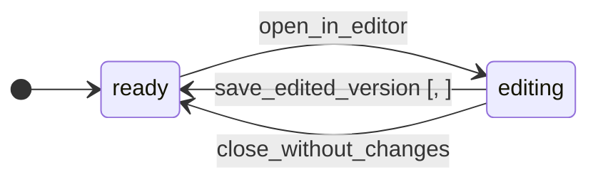

# Document Workspace

`workspace`

## Purpose & classification

> Create an independent document from a template, edit it, list it under My documents and download it.

**Subdomain type:** core · **Status:** target · agreed goal · **Strategic importance:** high

**Context map patterns:** customer–supplier, anti-corruption layer

The workspace holds the documents users create from templates. It copies the template file, keeps each saved version and serves downloads.

**Subdomain:** Document Workspace (core)

Documents users create from templates, edit and download. Copy isolation lives here.

## Ubiquitous language

| Term | Source | Note |
|---|---|---|
| `DocumentId` | domain-primitive | Identifies one document. |
| `TemplateOrigin` | value-object | A snapshot of the source template id, revision and name, taken at creation. |
| `EditorKey` | value-object | The cache key the editor uses for one document version. |
| `TemplateKind` | value-object | Type of field kind on Document |
| `StoredFile` | value-object | Type of field file on Document |
| `DocumentStatus` | value-object | Type of field status on Document |

## Aggregates

### Document · `documents`
_target · agreed goal_
A document is the user's own copy of a template. It holds its file, its origin and its current version. It never shares storage with a template.
**Identity:** `id : DocumentId`. Identifies one document.
> Must be correct together: file, version and editor key.
**Invariants:**
- The document file lives in the document store, never in the template store.
- The document kind equals the kind of its source template.
- Every saved version gets a new editor key.
- The version increases by one on every saved version.
**10 fields:**
| Field | Type / reference | Required | Description |
|---|---|---|---|
| `id` | `DocumentId` | yes |  |
| `kind` | `TemplateKind` | yes |  |
| `title` | `string` | yes | Defaults to the template name. |
| `origin` | `TemplateOrigin` | yes | Template id, revision and name at the moment of creation (D2: a template update creates a new revision). |
| `file` | `StoredFile` | yes |  |
| `version` | `integer` | yes |  |
| `editorKey` | `EditorKey` | yes |  |
| `status` | `DocumentStatus` | yes |  |
| `createdAt` | `datetime` | yes |  |
| `updatedAt` | `datetime` | yes |  |

## Identity & building blocks

**Identity**: what names exactly one record. It separates an entity from a value object.

| Aggregate | Field | Type | Rule |
|---|---|---|---|
| Document | `id` | `DocumentId` | Identifies one document. |

**Value object** (2)

| Building block | Purpose | Detail | Scope |
|---|---|---|---|
| `TemplateOrigin` | A snapshot of the source template id, revision and name, taken at creation. |  | aggregate, in document |
| `EditorKey` | The cache key the editor uses for one document version. | It changes after every saved version. | aggregate, in document |

**Domain primitive** (1)

| Building block | Purpose | Detail | Scope |
|---|---|---|---|
| `DocumentId` | Identifies one document. |  | aggregate, in document |

**Factory** (1)

| Building block | Purpose | Detail | Scope |
|---|---|---|---|
| `DocumentFactory` | Creates a document from a published template by copy-on-create. | Copy the template file into the document store.; Verify the copy's checksum.; Record the template origin. | aggregate, in document |

**Repository** (1)

| Building block | Purpose | Detail | Scope |
|---|---|---|---|
| `DocumentRepository` | Reads and writes Document records. |  | aggregate, in document |

**Port** (2)

| Building block | Purpose | Detail | Scope |
|---|---|---|---|
| `FileStorage` | Reads and writes files by storage key. The template store is read-only to the workspace. |  | integration |
| `EditorGateway` | Builds an editor configuration for a document and delivers save callbacks as workspace commands. |  | integration |

**Read model** (1)

| Building block | Purpose | Detail | Scope |
|---|---|---|---|
| `MyDocumentsView` | Documents newest first with title, kind, origin and last saved time. |  | bounded-context |

**Not modelled yet:** `entity`, `domain-service`, `specification`, `policy`. This is not always a gap: a supporting domain often keeps its rules inside the aggregate root.

## Lifecycle

### Document · `DocumentStatus`
A document is ready until someone opens it in the editor. Each saved version returns it to ready with a higher version.

**3 transitions**: guard, event emitted, what happens next

| From | Command | To | Guard | Emits | Then |
|---|---|---|---|---|---|
| ready | open_in_editor | editing | — | — | The editor loads the current version under the current editor key. · The user opens the document in the integrated editor. |
| editing | save_edited_version | ready | , | workspace.document.saved | The new file replaces the document's file. The version goes up by one and the editor key changes. · The editor reports that an edited version is ready to store. |
| editing | close_without_changes | ready | — | — | The editor reports that the session closed with no changes. |

## Commands & use cases

| Command / use case | From | Note |
|---|---|---|
| Use a template | User | The user picks a published template and gets a new document copied from it, then lands in the editor. |
| Edit a document | User | The user changes the document in the integrated editor. Saved changes persist to that document only. |
| Download a document | User | The user downloads the current version as DOCX or PPTX. |
| List my documents | User | The user sees earlier documents and reopens or downloads any of them. |
| open_in_editor | Document | The user opens the document in the integrated editor. |
| save_edited_version | Document | The editor reports that an edited version is ready to store. |
| close_without_changes | Document | The editor reports that the session closed with no changes. |

## Events

- command `save_edited_version` → aggregate `Document` → event **workspace.document.saved**; then The new file replaces the document's file. The version goes up by one and the editor key changes.

Commands that emit no event (nothing elsewhere can react): `open_in_editor`, `close_without_changes`

| Event | Happens when | Who listens |
|---|---|---|
| workspace.document.created | A user creates a document from a template. My documents shows it at once. | declared |
| workspace.document.saved | The editor stores an edited version. The next open and download serve this version. | declared |

## Rules & policies

**invariant** (5)

| Rule | Declared on | Status |
|---|---|---|
| Creating a document copies the template file to new storage. The template file is never opened for writing. | Document Workspace | target · agreed goal |
| The document file lives in the document store, never in the template store. | Document |  |
| The document kind equals the kind of its source template. | Document |  |
| Every saved version gets a new editor key. | Document |  |
| The version increases by one on every saved version. | Document |  |

**policy** (1)

| Rule | Declared on | Status |
|---|---|---|
| A document can be created only from a published template (D4: an archived template leaves the gallery but its documents keep working). | Document Workspace | target · agreed goal |

**authorization** (1)

| Rule | Declared on | Status |
|---|---|---|
| The workspace accepts a saved version only from a signed editor callback. | Document Workspace | target · agreed goal |

## Integration & hotspots

| Direction | Context | Kind | Via | Pattern | Status |
|---|---|---|---|---|---|
| calls | Template Catalog | port | TemplateSource port | customer–supplier | target · agreed goal |
| calls | Editor Integration | port | EditorGateway port | anti-corruption layer | target · agreed goal |

**Open questions** (1)

- Are renaming and deleting a document in scope? _(Adds two commands and a terminal state to the Document lifecycle, and extends My documents.; who answers: Project owner)_

**Related decisions** (3)

| Decision | Why | Status |
|---|---|---|
| The domain has three bounded contexts: Template Catalog (core), Document Workspace (core) and Editor Integration (generic, an anti-corruption layer over ONLYOFFICE). | Catalog and workspace carry the scored rules. The editor is bought. | accepted · approved |
| Updating a template creates a new revision with a new stored file. No template file is overwritten, and a document records the template id and revision it came from. | Keeps template immutability absolute and every document traceable. | accepted · approved |
| An archived template leaves the gallery and cannot be used for new documents. Documents created from it keep opening, saving and downloading. | Documents are independent copies. | accepted · approved |
