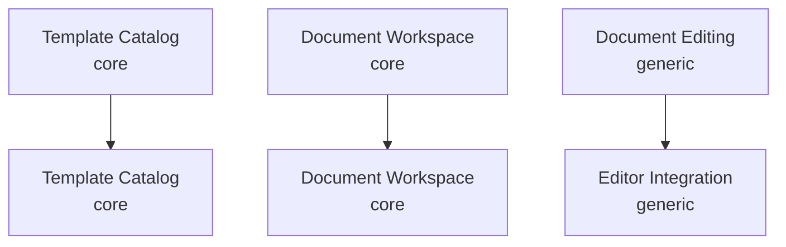

# Strategic Domain Map

**Primary domain:** `Office template library: users pick a DOCX or PPTX template, get their own copy and edit it in the browser.`

The brief scores template handling and copy isolation, so the catalog and the workspace are core. Editing office files is a solved problem, so the editor is bought (ONLYOFFICE) and kept behind an anti-corruption layer.

## Classification

| Subdomain | Type | Contexts | Description |
|---|---|---|---|
| `Template Catalog` | `core` | catalog | Templates, categories and previews that users browse, search and preview. |
| `Document Workspace` | `core` | workspace | Documents users create from templates, edit and download. Copy isolation lives here. |
| `Document Editing` | `generic` | editor-integration | In-browser editing of office files and preview rendering, supplied by ONLYOFFICE Document Server. |
